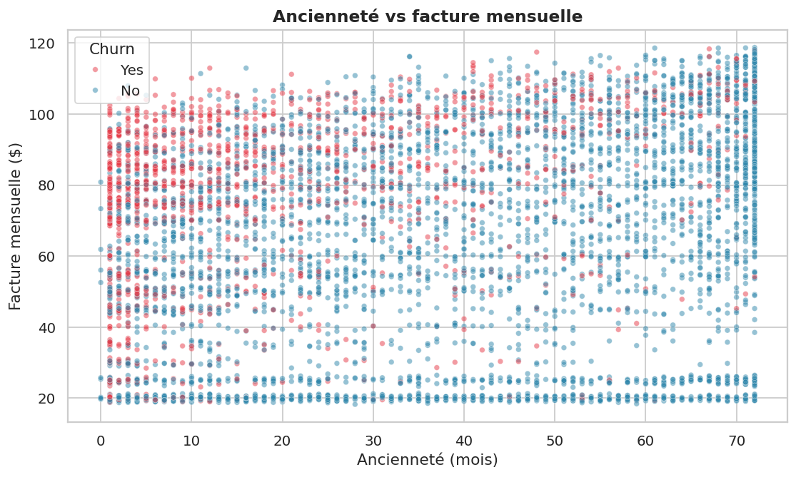
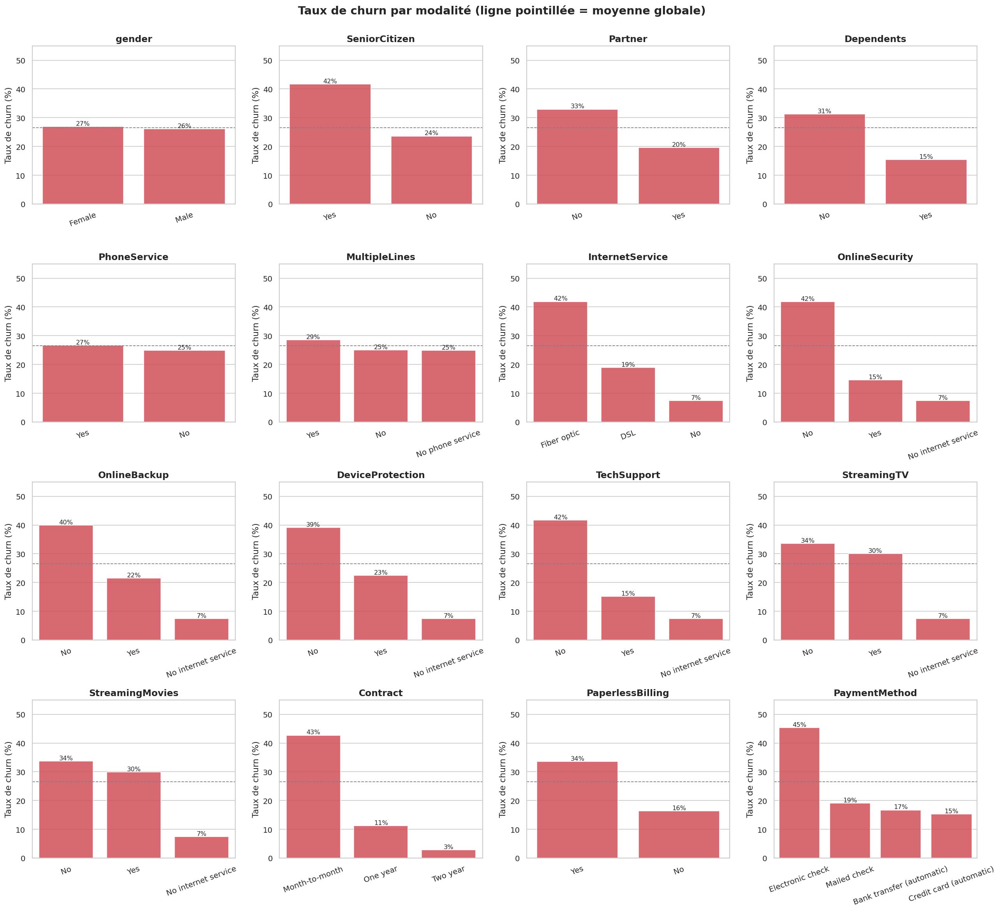
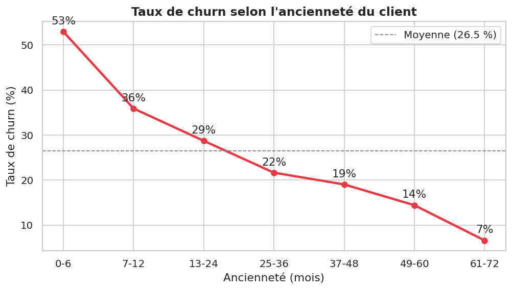
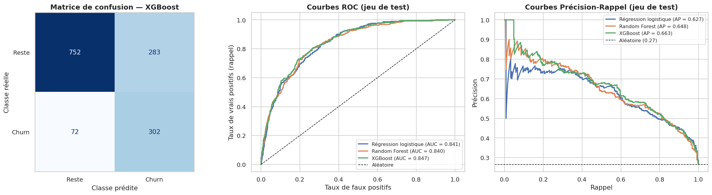
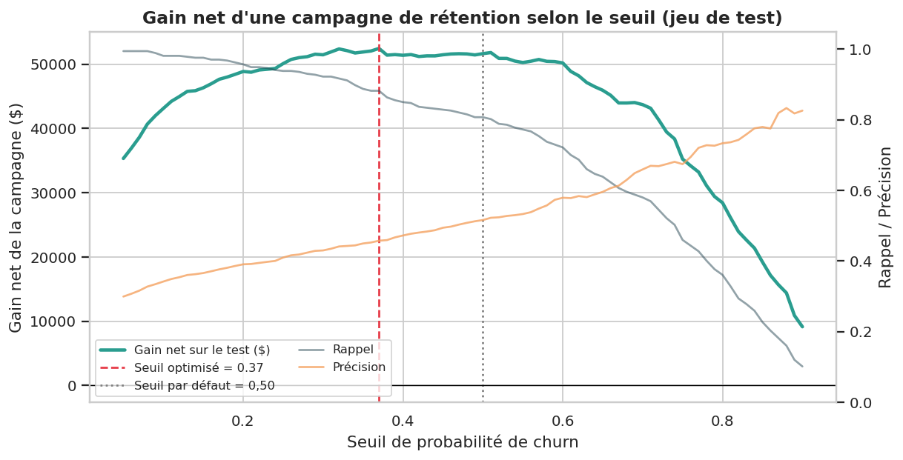
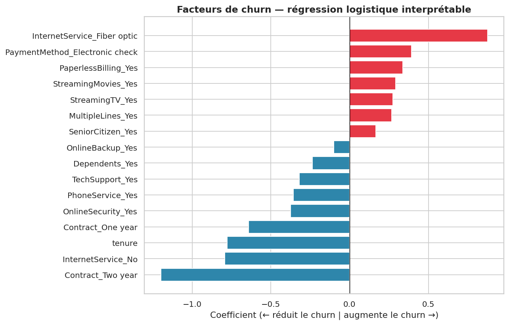
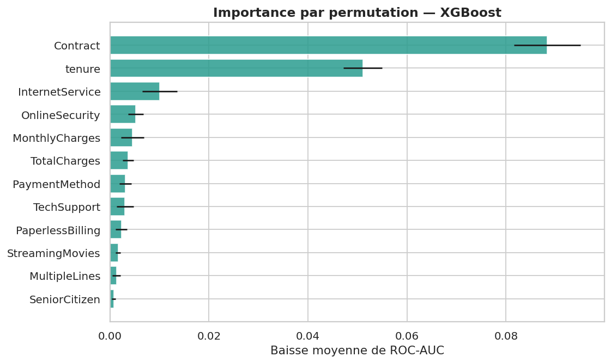

<h1 align="center">📉 Prédiction du churn client — Telco</h1>

<p align="center">
  <em>Identifier les clients sur le point de résilier leur abonnement et transformer un modèle de Machine Learning en décision business chiffrée.</em>
</p>

<p align="center">
  
  
  
  
  
  
</p>

<p align="center">
  
</p>

---

## 🧭 En bref

| | |
|---|---|
| **Problème** | Un opérateur télécom perd **26,5 %** de ses clients. Lesquels vont partir, et pourquoi ? |
| **Données** | [IBM Telco Customer Churn](https://www.kaggle.com/datasets/blastchar/telco-customer-churn) — 7 043 clients, 21 variables |
| **Approche** | EDA → feature engineering → comparaison de 4 modèles → optimisation → seuil de décision orienté profit → interprétation |
| **Résultat** | **ROC-AUC de 0,85** sur le jeu de test, **~80 % des churners détectés**, ciblage **~2× plus rentable** qu'une campagne de masse |

📓 **[Voir le notebook complet](notebooks/churn_prediction.ipynb)** · 🌐 **[Version HTML](reports/churn_prediction.html)** (à télécharger et ouvrir dans un navigateur)

---

## 🔍 Principaux enseignements

<p align="center">
  
</p>

| Facteur de risque | Taux de churn | Point de comparaison |
|---|---|---|
| Contrat **mensuel** | **43 %** | 3 % en contrat 2 ans |
| **6 premiers mois** d'ancienneté | **53 %** | 7 % après 5 ans |
| **Fibre optique** | **42 %** | 19 % en DSL |
| Paiement par **chèque électronique** | **45 %** | 15 % par carte automatique |
| **Sans** sécurité en ligne / support technique | **42 %** | ~15 % avec |

<p align="center">
  
</p>

---

## 🤖 Modélisation

- **Pipeline scikit-learn** (standardisation + one-hot encoding) → aucune fuite de données entre train et test.
- **Déséquilibre des classes** géré par pondération (`class_weight`, `scale_pos_weight`) et métriques adaptées (ROC-AUC, PR-AUC, rappel, F1 plutôt que l'accuracy).
- **Validation croisée stratifiée à 5 plis**, puis optimisation (`GridSearchCV`, `RandomizedSearchCV`).

| Modèle (jeu de test) | ROC-AUC | PR-AUC | Rappel | Précision |
|---|:---:|:---:|:---:|:---:|
| Baseline (classe majoritaire) | 0,500 | 0,265 | 0,00 | — |
| Régression logistique | 0,841 | 0,627 | 0,78 | 0,51 |
| Random Forest | 0,840 | 0,648 | 0,74 | 0,55 |
| **XGBoost optimisé** ✅ | **0,847** | **0,663** | **0,81** | 0,52 |

<p align="center">
  
</p>

---

## 💰 Du score à la décision business

Le seuil de 0,5 est arbitraire. On simule une **campagne de rétention** (offre à 50 $, 30 % de succès, valeur client = 12 mois de facturation) et on choisit le seuil qui **maximise le gain net**. Ce seuil est sélectionné sur des prédictions hors-échantillon du train, puis évalué une seule fois sur le test.

| Stratégie (jeu de test, 1 409 clients) | Clients ciblés | Churners captés | Gain net |
|---|:---:|:---:|:---:|
| Cibler tout le monde | 1 409 | 100 % | 27 524 $ |
| Modèle, seuil 0,50 | 585 | 81 % | 51 650 $ |
| **Modèle, seuil optimisé (0,37)** | **721** | **88 %** | **52 462 $** |

<p align="center">
  
</p>

---

## 🧠 Interprétabilité

Pour expliquer le modèle sans être piégé par la **multicolinéarité** (ex. `MonthlyCharges` ≈ somme des services), une régression logistique simplifiée et régularisée a été entraînée — avec quasiment la même performance (ROC-AUC 0,845). Ses coefficients sont confirmés par l'importance par permutation du modèle XGBoost.

<p align="center">
  
  
</p>

---

## 🎯 Recommandations métier

1. **Convertir les contrats mensuels** en contrats 1 ou 2 ans (remise, mois offert) — le levier le plus puissant.
2. **Renforcer l'onboarding** sur les 6 premiers mois, période où plus d'un client sur deux part.
3. **Auditer l'offre fibre** (prix, qualité, pannes) : c'est l'offre premium, mais aussi celle qui perd le plus de clients.
4. **Pousser le paiement automatique** plutôt que le chèque électronique.
5. **Proposer sécurité en ligne et support technique** en essai gratuit.
6. **Prioriser les campagnes** avec le score du modèle et le seuil optimisé.

---

## 🗂️ Structure du projet

```
churn-prediction/
├── data/
│   └── telco_customer_churn.csv     # Jeu de données brut
├── notebooks/
│   └── churn_prediction.ipynb       # Analyse complète (EDA → modèle → recommandations)
├── reports/
│   └── churn_prediction.html        # Export HTML du notebook, lisible sans Jupyter
├── images/                          # Figures générées par le notebook
├── models/
│   └── churn_model.joblib           # Pipeline entraîné + seuil de décision
├── src/
│   └── predict.py                   # Script pour scorer de nouveaux clients
├── requirements.txt
└── README.md
```

## ▶️ Reproduire le projet

```bash
git clone https://github.com/<TON-PSEUDO>/churn-prediction.git
cd churn-prediction
python -m venv .venv && source .venv/bin/activate   # Windows : .venv\Scripts\activate
pip install -r requirements.txt

# Relancer l'analyse
jupyter notebook notebooks/churn_prediction.ipynb

# Scorer des clients avec le modèle entraîné
python src/predict.py --input data/telco_customer_churn.csv --output predictions.csv
```

## 🔭 Pistes d'amélioration

- Explications individuelles avec **SHAP** et calibration des probabilités.
- **Analyse de survie** pour prédire *quand* un client va partir.
- Démo interactive (**Streamlit**) ou API (**FastAPI**) pour mettre le modèle en production.
- Validation de l'impact réel des actions de rétention par **test A/B**.

---

<p align="center">
  👤 <strong>Faugué Titouan</strong> · <a href="www.linkedin.com/in/titouan-faugué">LinkedIn</a> · <a href="https://github.com/titoufaugue">GitHub</a>
</p>
